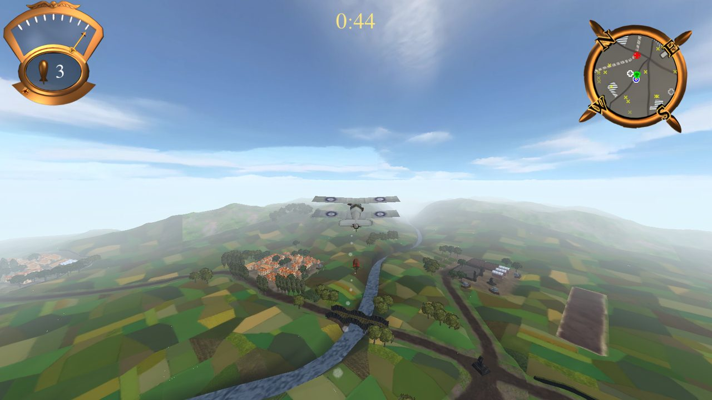
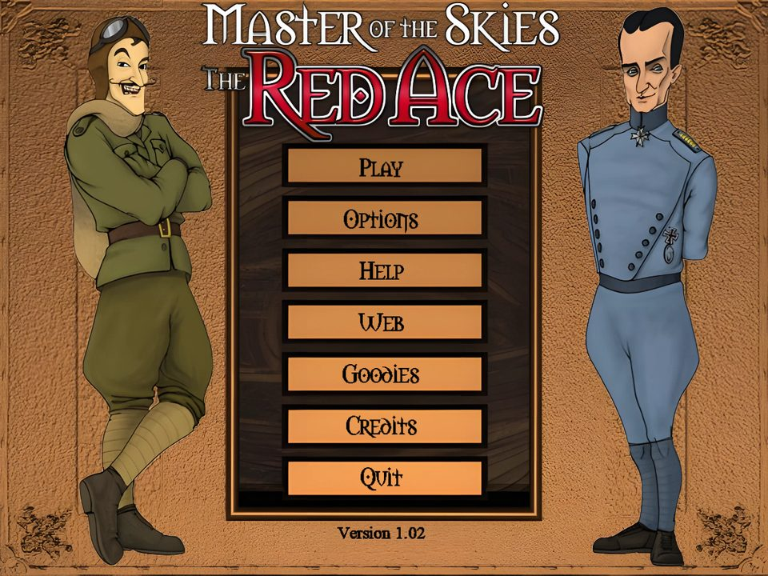
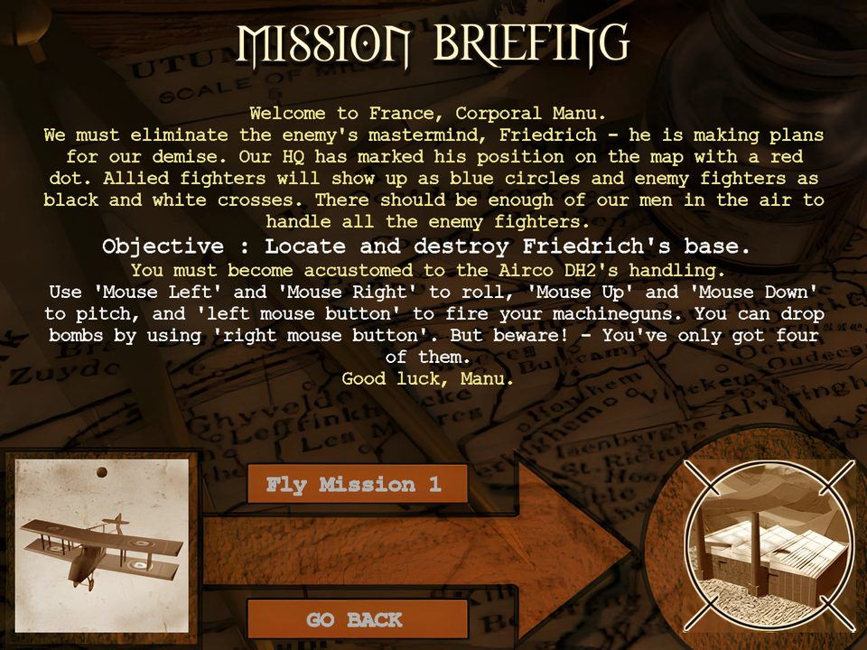
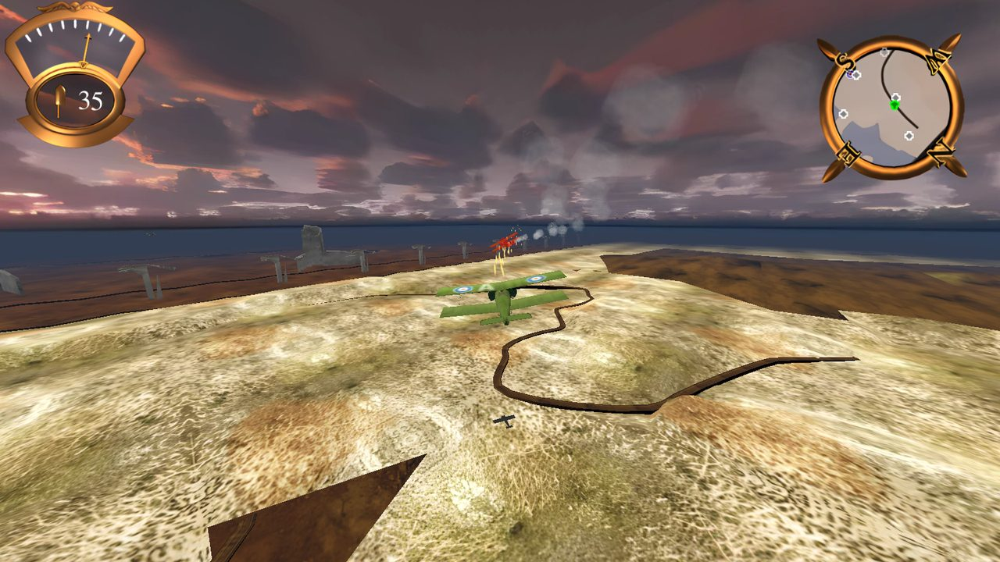
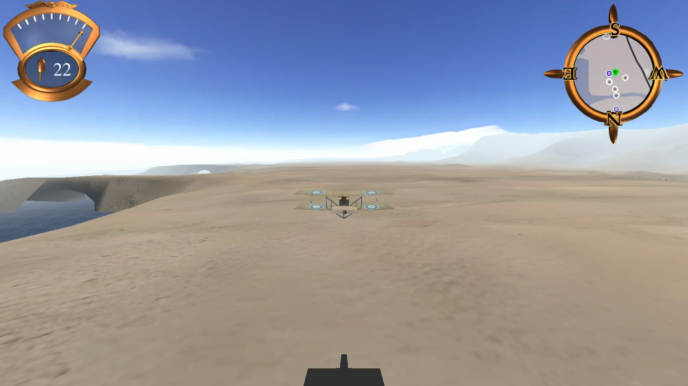
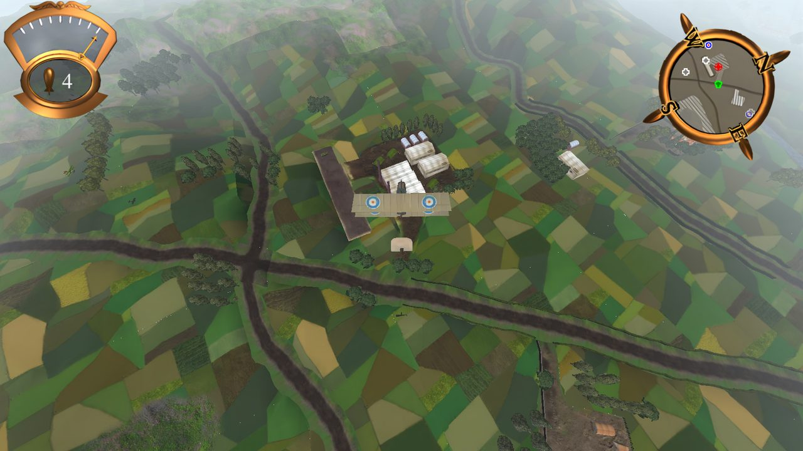
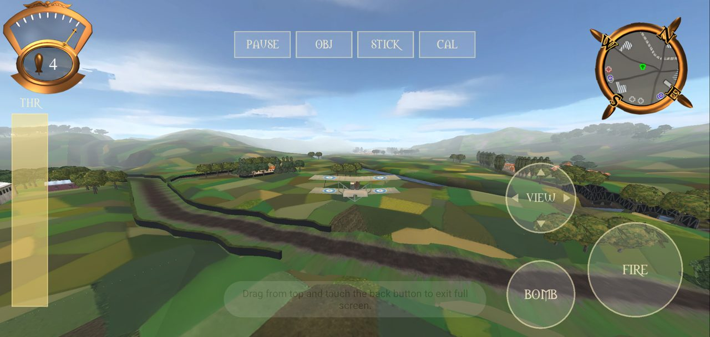
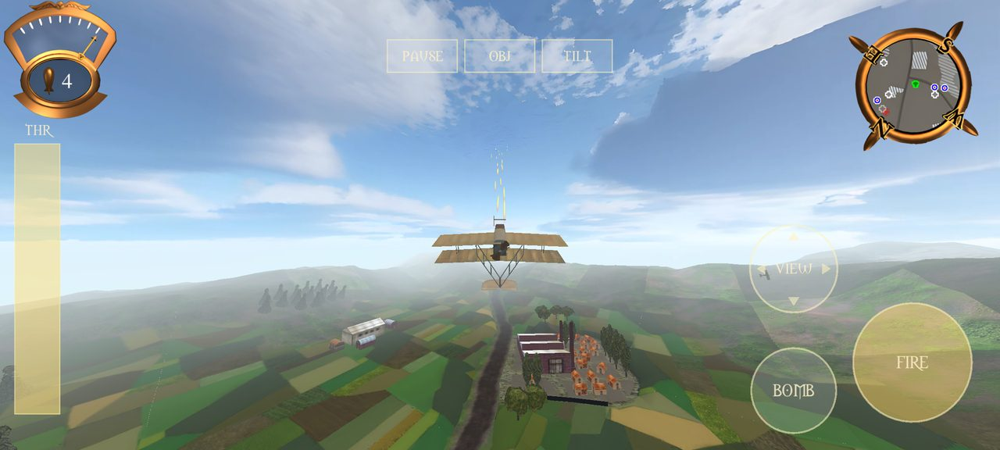

<div align="center">

# Red Ace Remake

**Master of the Skies: The Red Ace** (Small Rockets, 2001) rebuilt in Godot 4 —
the original WWI flight game's missions, menus and game logic, playable in the browser, on desktop and on Android.

<a href="https://manuvarkey.github.io/redace_re/"></a>
&nbsp;
<a href="https://github.com/manuvarkey/redace_re/releases/latest"></a>


<br><br>



</div>

## Screenshots

| | |
| :---: | :---: |
|  Main menu, drawn from the original HTML pages |  Mission briefing |
|  Trenches at dusk |  Desert campaign |
|  Held camera views |  Phone browser with touch controls |

## Features

- **The whole game:** all 28 missions on the three original maps (country, desert, trenches), the
  campaign with pilot roster, ranks and promotions, briefings and debriefings, cheats and replay levels.
- **Faithful logic:** flight model, AI, weapons, damage, scoring and the HTML menu engine follow the
  decompiled `RedAce.exe`; the details are in [Technical notes](#technical-notes).
- **Original assets, refreshed:** models, maps and art converted from the game, art upscaled 4x
  (Real-ESRGAN), the card trees and palms remodelled in Blender.
- **Plays anywhere:** web (WebGL 2), Windows, Linux and Android, with touch controls and tilt
  steering on phones.

## Download and play

| Platform | How |
| --- | --- |
| **Browser** (desktop or phone) | [manuvarkey.github.io/redace_re](https://manuvarkey.github.io/redace_re/), nothing to install |
| **Windows** | [Releases](https://github.com/manuvarkey/redace_re/releases/latest): unzip `redace-*-windows-x86_64.zip`, run `redace.exe` |
| **Linux** | [Releases](https://github.com/manuvarkey/redace_re/releases/latest): unzip `redace-*-linux-x86_64.zip`, run `redace.x86_64` |
| **Android** | [Releases](https://github.com/manuvarkey/redace_re/releases/latest): install `redace-*-android.apk` (allow installs from unknown sources) |

## Controls

<table>
<tr><th>Desktop (mouse, the default)</th><th>Phone (touch)</th></tr>
<tr><td valign="top">

| Action | Input |
| --- | --- |
| Roll / pitch | Mouse (back = nose up) |
| Throttle | Right Shift / Right Ctrl |
| Guns / bombs | Left / right mouse button |
| Turbo boost (cheat) | Space |
| Camera views (held) | Arrow keys |
| Pause | Esc |
| Objectives | Tab |

</td><td valign="top">

| Action | Input |
| --- | --- |
| Roll / pitch | Tilt the phone, or STICK: drag on the left |
| Throttle | THR slider, left edge |
| Guns / bombs | FIRE / BOMB |
| Turbo boost (cheat) | BOOST |
| Camera views (held) | VIEW: hold and swipe |
| Pause | PAUSE, or Android back |
| Objectives | OBJ |

</td></tr>
</table>

Keyboard and joystick layouts and rebinding are on Options > Controls, as in the original.

<p align="center"></p>

## Build from source

The converted game data is in `redace/game_data/`, so only Godot 4.7.2 and its export templates are needed:

```sh
GODOT=~/tools/godot-4.7.2/Godot_v4.7.2-stable_linux.x86_64 ./build.sh   # Web, Linux and Windows
./build.sh Web Android                                                  # any presets
scripts/build_linux.sh                                                  # one preset: build_windows.sh, build_web.sh, build_android.sh
```

| Output | Path |
| --- | --- |
| Web | `build/web/index.html` |
| Linux / Windows | `build/linux/redace.x86_64`, `build/windows/redace.exe` (each with `redace.pck`) |
| Android | `build/android/redace.apk` (debug-signed, arm64-v8a + x86_64) |

- **Fonts:** `build.sh` first puts the Microsoft core fonts (Arial, Courier New, Times New Roman, Verdana)
  into `redace/fonts/`, copied from `/usr/share/fonts/truetype/msttcorefonts` or downloaded from the
  corefonts cabinets on SourceForge (needs `curl` and `cabextract`). They are not redistributable, so
  they are not in the repository.
- **Android:** Godot's editor settings must name the Android SDK and a JDK 17+
  (`export/android/android_sdk_path`, `java_sdk_path`); the debug keystore is made in `build/` on first use.
- **Web:** serve `build/web` from any static server, e.g. `python3 -m http.server -d build/web`, then open
  `http://localhost:8000/` (`?mission=N` flies a mission directly, plus `&autopilot` and `&view=N`). The
  no-threads template needs no COOP/COEP headers.
- **Game data:** to regenerate `redace/game_data/` from the original CD (Python 3 + Pillow, ffmpeg):
  `python3 tools/isextract.py <cd>/apps <game>`, then `python3 tools/build_assets.py <game> <REDACE.CUE> redace`.

<details>
<summary><b>Embedding in a web page</b></summary>

To embed in a web page (e.g. a Blogger post), upload `build/web` to any https static host and paste
`build/web/blogger-snippet.html` into the post's HTML view with `GAME_URL` set to the hosted
`index.html`. The snippet shows `poster.jpg` with a Play button and only then creates the iframe
(`allow="autoplay; fullscreen; gamepad; pointer-lock"`). Tested cross-origin in headless Chromium.

</details>

### Continuous integration

- `.github/workflows/pages.yml` builds the web export on every push to `main` and deploys it to GitHub Pages
  (one-time setup: Settings > Pages > Source = GitHub Actions).
- `.github/workflows/release.yml` builds all four presets when a `v*` tag is pushed and attaches them to
  the release: `git tag -a v1.1 -m "..." && git push origin v1.1`.

## Repository layout

| Path | Contents |
| --- | --- |
| `redace/` | Godot project: `scripts/` (game logic), `scenes/`, `game_data/` (converted original data) |
| `overrides/` | Remodelled trees and palms, copied over `game_data/` (Blender sources in `overrides/blend/`) |
| `tools/isextract.py` | Pure-Python InstallShield 5/6 cabinet extractor |
| `tools/build_assets.py` | Builds `redace/game_data` from the extracted game (models, maps, art, music, help) |
| `tools/rw2gltf.py`, `tools/rwdump.py` | RenderWare 3.1 `.dff`/`.bsp` to glTF 2.0 converter; chunk tree dump |
| `tools/blender_tree.py` | Low-poly tree generator for the `overrides/` models (run inside Blender) |
| `tools/redace-wine.sh` | Runs the original game or the Windows export under Wine for comparison |
| `tools/ghidra_scripts/` | Ghidra headless scripts (`ExportAll`, `ImproveAnalysis`, `ApplyGuids`) for the `RedAce.exe` decompilation |

## Thanks to the original team

This project exists because *Master of the Skies: The Red Ace* is a wonderful game: a small, witty,
hand-crafted WWI flight game with a lot of heart. Big thanks to the team at Small Rockets who made it,
as listed on the game's own Credits pages:

| Role | |
| --- | --- |
| Programming | Tim Aidley |
| Art | Anthony Callaghan |
| Mission design, sound effects | Adrian Moore (sound with thanks to Mike Ash) |
| Music | Ian Livingstone |
| Trenches level | Tomas O'Sullivan |
| Help file and web site design | Peter Lane |
| Producer | Shawnee Sequeira |
| Head of Fiendish Games | Jonathan Small |
| Quality assurance | Frank Parkinson, Gavin Parker, Neil Martin, Jonathan Biddle, David Burke, Simon Crawford, Mat Cunningham |

They in turn thanked the RenderWare team and BMB Compuscience for *Sopwith*. The menus, missions,
characters, art and music in this remake are theirs; this project only rebuilds the engine around them.
Thank you for the game, and for many happy hours in the air.

## Technical notes

How each part maps to the original executable (`FUN_...` and `RedAce.c:line` refer to the Ghidra decompilation).

<details>
<summary><b>Front end and campaign</b></summary>

The original HTML menu pages (`language/english/Menus`, `missions/*/mission.html`) are drawn by
`scripts/html_view.gd` on the original 640x480 page. Parsing and layout follow the exe's own HTML engine
(decomp `FUN_0040d648`/`FUN_0040df35` parser, `FUN_0040b0d8` line layout, `FUN_0040bd80`/`FUN_0040bf13`
tables, `FUN_0040c1b0` alignment): items sit at the top of their line and cells at the top of their box;
column widths and row heights are the declared or natural sizes scaled to the table size; content that
does not fit a cell's height is dropped; links run on across cells until `</a>`; spacing br 0, wrap 0,
paragraph 3, alignment 2. Checked pixel for pixel against the original under Wine (options, graphics,
video, sound, controls, cheats, play, roster, replay levels, pause, credits).
Deliberate deviations, each keeping every row where the original has it:
  - tables without a width draw their cells at natural width instead of squeezed ones (row heights still
    come from the squeezed layout), so the Controls page shows "Controller"/"Sensitivity" in full and
    "Fire Second Weapon" on one line, and the volume bars keep their right end cap (the exe cut words to the
    cell and moved a wrapped image out of sight); such a table may run a few pixels past its cell;
  - the Controls page's "Set to default for: Mouse / Joystick / Keyboard" row, which the exe drops for lack
    of room, goes into the empty Sensitivity cells of the Fire Guns to Camera Left rows (`game.gd`
    `_controls_defaults_row`).
`scripts/game.gd` fills the pages' `^placeholders^`
with the same HTML snippets the exe generated and handles their links (`command:`, `play:N`,
`characterplay:N`, ...):

- title screen (5 s), main menu, options (sensitivity, volumes, view distance, effects detail, vsync,
  window mode, control layout), credits, goodies (replay levels, demo levels, cheats after finishing).
- pilot roster with 6 slots (type a name, Enter), Start/Continue Campaign, briefings, Fly Mission,
  loading page, pause page (Esc: continue, restart, abort), result pages (victory, promotion,
  debriefings, defeat with the reason: plane destroyed, mission critical object lost, out of time),
  congratulations after mission 25.
- ranks Corporal..Colonel promoted at scores 700, 1800, 2800, 4000, 5400, 7000, 8800, 10800, 12600,
  14400 (exe tables at 0x51af4c / 0x51b1cc); mission score = 500 for a win + 100 - % surviving for each
  destroy group + % surviving for each protect group (`FUN_00446aa1`).
- Pilots and settings are saved in `user://pilots.cfg` and `user://settings.cfg`.
- Menu music is music.ini entry 2; missions use their `[music] track` entry (CD track N + 1).
- Cheats as in the original options page: turbo boost on Space, infinite bombs/rockets,
  invulnerability, game speed, enemy endurance.

</details>

<details>
<summary><b>Controls in detail</b></summary>

Bindings follow the original control files (`redace.ini` = `mousekeys.ini` by default; `keyboard.ini`,
`joystick.ini`): Options > Controls lists each action with its controller and value. Click an action, then
press a key, move the mouse (axes) or press a mouse/joystick button to rebind it; "Set to default for"
loads one of the three files. Sensitivity bars and "Reversed?" boxes as in the original.

Esc (or P) in flight opens the pause page (Continue, Restart Mission, Abort Mission). On the web,
the browser's own Esc releases the mouse; that also opens the pause page.
In flight `[` `]` and `-` `=` nudge roll / pitch sensitivity; Tab shows objectives and a debug line.

**Touch controls** (`scripts/touch.gd`, not in the original) appear from the first touch. Tilt steering
uses the accelerometer, with neutral = how the phone is held at mission start or on CAL; STICK, or a phone
without a sensor, switches to a virtual stick dragged on the left half. Steering goes through the joystick
path, so the Controls page sensitivities apply. On the web the first tap goes fullscreen and locks
landscape, and tilt comes from `devicemotion` (head script in the Web preset). The Android back button
pauses and resumes a flight and steps back through the menus; new pilot names open the on-screen keyboard.
Tested on the Android 14 emulator (x86_64, host GPU) and in its Chrome.

</details>

<details>
<summary><b>Debugging</b></summary>

Mission audit: `godot --headless --path redace -s tools/audit_missions.gd` loads every mission and
lists unplaced objects, missing models/sounds, bad goal targets, objects off the map or under the terrain.

Debug flags (desktop, after `--`): `--mission=N` (skip the menus), `--autopilot`, `--view=N` (hold camera
mode 1/4/6/7/8), `--perf`, `--pages=Menus\a.html,...` (show pages), `--clicks=href,key:esc,...` (follow links).

</details>

<details>
<summary><b>What is implemented</b></summary>

- All 28 missions load from the original `mission.ini`: map, ground objects, vehicles, aircraft, music track.
- 3 maps (RenderWare `.bsp` worlds), 159 models (`.dff`), sky boxes, fog colour, briefings from `mission.html`.
- Flight model from the decompiled plane update (`decomp/RedAce.c:32540`): throttle/climb/dive target speed,
  acceleration, lift = speed^2 * mass * 10 / cruisespeed^2, gravity mass * 10, speed-dependent roll/pitch rates,
  stall, altitude ceiling at 400, runway take-off. Values come from each `plane.ini`.
- Guns as in the original (`RedAce.c:31605`): `firerate` rounds per second in bursts of `fireon` s
  with `fireoff` s pauses. Projectiles use `objects/ordinance/ordinance.ini`: bullet (damage 1, spread 0.04),
  bomb (damage 75, blast 30), rocket (damage 50, blast 20), AA fire (damage 2.5). Rounds fly at
  `releasespeed` plus the firer's velocity plus a per-axis random +-`jitter * maxspeed`, for up to 10 s or until
  they leave the map. The burst clock runs only with the trigger held and is never reset (0x430444).
- Bombs (`ordinancetype = 1`) and rockets (`2`) with the mission's `numordinance` count.
- Every `[vehicleN]` is a turret (`FUN_0043c1c0`; the exe never reads `[ai] turret`, so tanks fire too): it aims at
  the nearest member of the mission's `targetgroup` (default 8; a ground object there keeps it idle until a plane is
  nearer), kept until dead or over 200 away, with a lead of
  speed * distance * 0.005, firing within `range` (ground distance, default 300), inside the cone `angle` (default
  1.57) about its facing, and above 0.2 elevation.
- Mission rules from the decompiled check (`FUN_00446b7b`, `RedAce.c:40170`): object `groups` bitmask;
  `GroupN = -P` destroy P % of group N to win, `GroupN = +P` fail when fewer than P % survive (groups 0-9),
  `timelimit` in seconds. Hidden planes count as lost (`FUN_0043b70a`), and so do group 9 planes that flew 150
  past the world box (0x439046), so reinforcements that never appear do not hold up a mission.
- Starts and aircraft scripts (`[airNgoalK]`) follow the decompiled pilot code (`FUN_00436f41`, goal list
  built by exact type at `RedAce.c:34449`, run one at a time by `FUN_00438937`). Every aircraft, the
  player's too, is created parked (state 4, speed 0) at its mission position; then its goals run:
  0x100 moves it to the goal position in the air at full throttle and `highspeed` (Training 1/2, most
  missions), 0x170 hides it, 0x160 shows it after N s, 0x120 shows it when the group/object `targetid`
  member nearest to it is within N of the goal position (reinforcements), 0x130/0x140 switch "retaliate
  when hit" on/off, 0x10 take off, 0x20 waypoint, 0x30 formation on an object, 0x60 evade, 0x70 gun
  attack, 0x80 dive attack with rockets, 0x90 level bombing run (0x80/0x90 turn into gun attacks once the
  ordnance is spent). With no goals left a plane flies to random points of the battle area; it never
  shoots outside an attack goal. Other type values (mission 3's player has 0x102) are
  dropped like the original, so those planes start parked (verified against the original under Wine:
  Training 1 starts airborne, mission 3 on the runway). Hidden planes are not drawn, targeted or hit.
  `targetid <= 0` means group `-targetid` (bit of `groups`). Mission entries may override `endurance` and
  `highspeed`. On the ground a plane sits gear height + 0.05 above the terrain (along its slope) and nose-up
  by atan(gear / tail), resting on wheels and tail skid: gear = -min y and tail = -min z of the clump's
  vertices, the values the exe puts in place of plane.ini's [collision] lengths (`FUN_0042e91a`,
  RedAce.c:30730). Touch-down happens when the gear meets the ground: sinking slower than 5 and wings
  near level lands, faster crashes.
- Edge of the battle area: warning near the edge, flown back when outside (strings.ini messages).
  Aircraft on the ground stay parked until their script says take off.
- AI steering follows the goal handlers (`FUN_00439376` steer, `FUN_0043b2a8` terrain pull-up,
  `FUN_00439e6f` 0x70, `FUN_0043a825` 0x80, `FUN_0043ad4b` 0x90, `FUN_00439206` 0x30): bank = -90 * target
  direction . right (full bank toward its side when behind), pitch rate = 90 * direction . up, bank change
  limited to 3 * rollrate deg/s, commanded pitch rate decays when no goal sets it (waiting planes circle).
  Gun attack: leads aircraft by distance / 275 * speed, matches their speed (throttle 0.65..1), fires when
  the target is within 37 deg and 300, turns hard to a random side when it is behind, breaks off above 80 %
  damage or after the 0x130 time limit. Dive attack: approaches 350 above, dives inside 300, fires rockets
  lined up within 225, climbs away (+250) when low or overhead. Bombing run: 140..160 above the target,
  releases when the predicted impact is within 30, goes round after overflying. When hit (`FUN_00437af6`):
  evade for 0.5 s toward a random point beside, or with 0x130 on attack the attacker. Planes sidestep the
  nearest group-8 aircraft (player side) when about to collide (`FUN_004394df`), and turn back 500 from
  the battle edge when idle.
- HUD with objectives and time left, minimap (`map.png`) with allied/enemy aircraft, objectives and AA guns.
- Engine, gun, hit and explosion sounds from each object's INI; CD music tracks.
- Controls, flight attitude, camera and HUD follow the decompiled code:
  - input `FUN_004322de`: mouse bank += (s * 0.25 + 0.025) * dt * highroll * mickeys, pitch rate +=
    (s * 2.5 + 0.25) * dt * highpitch * mickeys (dt fixed at the original 30 fps); keyboard bank +=
    (s + 0.1) * 7 * highroll * dt with auto-level at highroll deg/s.
  - attitude `FUN_00432a5f` (asm 0x4343a6-0x434440): unrolled flight frame, bank about forward for display,
    turn = sin(bank) * rollrate about world up, pitch rate decay 5 deg/s per frame, bank +-90 and roll-out flip.
  - camera `FUN_00435c19`/`FUN_0043572b`: chase/behind/left/right/above offsets, level horizon,
    90 deg vertical FOV, 4 * dt easing; views held on keys.
  - HUD `FUN_0042f026`/`FUN_0042f7db`/`FUN_0042fdc0`: status dial (throttle needle, bullet-hole damage,
    bomb/rocket count), heading-up map with compass ring and group 6-9 icons, timer.
- Propellers (atomics textured `soppropeller`) spin with the throttle.
- Damage and effects follow the decompiled code:
  - planes `FUN_0042eda0`: damage accumulates to `endurance` (bullet 1, AA 2.5); each hit adds smoke,
    plays `hitsound`/`althitsound` and throws a cloth particle; at endurance a mid-air burst, then the plane
    spins down trailing dark smoke and explodes on the ground (burst endurance * 0.1 + smoke column);
    damaged planes trail grey smoke at damage * 5 / endurance puffs per second (`RedAce.c:31878`);
    gentle ground contact lands instead of crashing.
  - ground objects `FUN_0042c00e`: model steps through `damagedff1..3` by damage fraction; destruction
    makes a burst (endurance * 0.03), a long smoke column (120..247 s) and the breakage sound.
  - bombs/rockets `FUN_0044d0df`: burst on a triangle of an object or the terrain, or on the bounding sphere of a
    plane's atomic (then centred on that plane). `FUN_0044cf81`: each atomic whose sphere meets the blast takes
    (blast - d) * damage with d = RenderWare's normalised distance (0..1, `0x4833f0`), 0.05x only for the plane
    that fired it, so one bomb in reach destroys any ground object.
  - rounds: fixed 1/60 s ticks in the exe (0x44a0af), Godot's physics rate here. Against planes in groups 4, 8, 9
    (`FUN_0044d311`, once per group): 1 hit on every tick within sqrt(back length * starboard length) of the
    clump box, about 12 units, and the round flies on, so one round can hit several times and any plane but its
    firer. Against objects and terrain (not AA fire) an exact geometry hit ends the round.
  - cheats and easing (`0x454a03`, `0x454b28`, `0x45cebb`): speed 0.2..2.2, enemy endurance (group 9) 0.0625..7.5625;
    from a pilot's third retry of a mission, per step (up to 5) group 8 endurance +6 % and game speed -1.4 %.
  - bullet impacts `FUN_0044cd2a`: maroon puff on terrain, hit spark on objects.
  - particle textures `objects/particles` (smoke, cloth, hit, maroon, clod) as camera-facing sprites.
- Fonts: `morpheus.ttf` and `annifont.ttf` from the game; the pages' Courier New, Times New Roman, Arial and
  Verdana are the Microsoft core fonts, put into `redace/fonts/` by `build.sh` (not redistributable, so
  not in the repository). Sizes follow the original HTML
  engine: cell height = size * 2 + 12 px, default face Arial (`FUN_004025e2`). Glyphs are drawn without
  antialiasing at the whole-pixel GDI advances; the exe copies GDI glyphs setting every touched pixel
  (`FUN_00429758`), which thickens strokes, so outlines are emboldened (`GLYPH_EMBOLDEN_PX`, lightened for readability
  for the game's fonts, `CORE_EMBOLDEN_PX` for Arial/Courier/... to match the original's heavier small text).
- Roster shows the exe's short rank names (Cpl., Sgt., ... table at 0x51b08c) and "New Pilot" on every
  empty slot; the Controls page shows mouse axes as "axis N" like the exe.
- All game raster art is upscaled at build time with Real-ESRGAN x4plus (`build_hires` in
  tools/build_assets.py, batch run with tile size 128 - the automatic tile size returned partly black
  images on this GPU): menu pages and briefing art 4x (HtmlView.ART_SCALE divides natural image sizes,
  so layouts are unchanged), sky boxes 4x, map / ground-object / plane textures 4x then Lanczos to 2x,
  wrap-padded so tiling textures stay seamless; alpha masks are upscaled separately. Images import as
  lossy WebP (quality 0.85) with mipmaps (project importer defaults), so the pck stays ~47 MB. The
  help pages (opened in the system browser) keep their original images.
- HUD, particle and map bitmaps are upscaled at build time for high resolutions: HUD art (dial, compass
  ring, throttle needle, bomb/rocket icons) and the minimaps 4x with Real-ESRGAN x4plus (colour and mask
  separately; `REALESRGAN` = path to `realesrgan-ncnn-vulkan`, default `~/tools/realesrgan/`; falls back to
  Lanczos), particles 4x with Lanczos + unsharp mask; the 8x8 map icons 8x with
  Scale3x twice then Lanczos (crisp edges), keyed on their top-left colour like the original (their masks
  are all opaque; the dark corners are transparent in the original); the HUD samples them with mipmaps.
- Mouse cursor: the original's own (`Ui/cursor.ini`: `menucursor.bmp` + mask), frame 0 (arrow) on all
  pages including over links, hotspot at the tip, Real-ESRGAN-upscaled and shown at the page scale.
- Collisions (`FUN_00431607` probes, `FUN_00430199`): nose/tail/wingtip/top/underside segments from the
  previous position, against other planes' and ground objects' triangles (box test first), as the exe tests atomics.
  Deviation: the probes keep plane.ini's [collision] lengths; the exe's wingspan-sized ones made the
  remake's formations collide constantly. Hitting a
  plane or solid object destroys the prober (endurance + 1); the other takes 2 * dt * endurance * 0.2
  (planes) or * 15 (ground objects); `[physics] soft = 1` objects (trees) wear the plane down instead.
  Nose into terrain crashes; a wingtip into terrain sends the plane into its falling spin.
- Joystick: an axis on Throttle is an absolute lever like the exe (a self-centring axis returns to half);
  a joystick button (or gamepad trigger) pressed on a Throttle/Roll/Pitch row binds upbutton/downbutton,
  stepped like keys (exe control type 7).
  Deviation: "Joystick" defaults (joystick.ini, throttle on axis 3 = a flight stick's Z lever) put the
  throttle on the triggers when a known gamepad is connected, since its axis 3 is self-centring.
- Plane shadows: each plane's `shadow` clump from plane.ini, flattened onto the ground under it
  (`RedAce.c:31814`).
- Sounds as the exe assigns them: menu click on every link, bullet-into-ground (`bulletground1`), bomb
  blast `explosionmedium2`, rocket blast `explosionsmall`, rocket launch / bomb hatch from plane.ini;
  plane hit: `hitsound`/`althitsound` at random on every hit; ground object: `hitsound` at 0.75 volume
  (default `bulletbuilding1`), `breakage` on each damage-model change and `explosion` when destroyed
  (both default `explosionsmall`, RedAce.c:29418).
- Ground damage models as the exe loads them (0x42b412): `deaddff` = wreck as stage 1 of 2 (60 object
  types, most placed objects), `damagedff1..3` = further stages; stage = trunc(damage / endurance *
  (stages - 1)) (FUN_0042c00e), so the wreck shows only when destroyed. Four inis name a model from
  another object's folder (aagun2-4 -> aagunruin.dff, oildrum -> Oilrigburn.dff); it is looked up there.
- Mission `[vehicleN]` sections are vehicles with turret AI (all real AA guns, tanks, ship turrets);
  `[groundN]` sections are scenery. The 94 placed `aagunruin` wrecks (ground sections) therefore never
  fire, though their ini says `turret = antiaircraft`.
- Model overrides: `overrides/` mirrors `game_data/` paths and is copied over the converted files
  last (`build_overrides`); `overrides/blend/` keeps the Blender sources. First one: `tree1` (`tree2.gltf`,
  281 trees in mission 1), remodelled in Blender with a tapered trunk, six branches and a lobed crown
  of leaf cards (376 triangles vs the original's 4 crossed cards), same footprint (40.8 x 43.3), original
  `tree1top` and `bark` textures, crown normals pointing out of the crown so it shades as a volume.
  The other card trees followed, generated by `tools/blender_tree.py` (run inside Blender; sources in
  `overrides/blend/trees.blend`): `tree2` poplar (column of card rings, 422 tris), `tree3` autumn
  broadleaf (lobed crown, 382 tris), `tree4` fir (drooping card tiers on a cone, 186 tris), each scaled
  to its original footprint and using its original foliage texture plus `bark.png` (tinted
  0.42/0.36/0.30). After export the glTF image paths are pointed at `../textures/`.
  Desert vegetation too: `palmtree` / `palmtree2` (855 placed) get a curved ringed trunk and 13 / 11
  arched, folded fronds (488 / 440 tris, was 50 / 78 faces); `desertscrub` (5394 placed) a star of
  five tilted cards plus three top cards (16 tris, was 12). Its wreck (`deaddff`) in the original is a copy
  of the 11-high burnt trunk the poplar, fir and palms use; it is replaced by a burnt scrub (the same
  card build, 9 x 4.5, textures tinted 0.14/0.11/0.09) in `overrides/.../desertscrub/treestumpburn.gltf`,
  which only the scrub's folder resolves to. `forest` is never placed; burnt stumps are
  wreck models and stay.
- Hit flash (FUN_0042c2b6 / FUN_0044a1bc): a plane hit, or a hit mission target (group 7), is drawn
  through 50 % red fog for 0.25 s.
- Bullets as the exe draws them (FUN_0044c4fe): camera-facing ribbons of `bullet.bmp` 20 units long ahead
  of the round, half-width = ordinance size (0.3 guns, 0.5 AA), alpha 0xc4. Gun hits on planes only give
  the plane's own effects (cloth scrap, knock, flash); on objects a `hit` puff, on the ground a `maroon`
  puff 8 above the impact (FUN_0044cd2a). Bombs and rockets on planes burst at the plane (FUN_0044ced8).
- Bomb and rocket smoke trails (RedAce.c:43373): 20 puffs/s (bombs, size 0.1) or 30/s (rockets, size
  0.75), grey 0.9 at alpha 0.7 fading 0.3/s, growing 2/s, drifting up 15/s.
- End of a flight (RedAce.c:51041, FUN_0045db9e): the world runs on for 2.5 s while the screen fades to
  black and music/effects fade out, with one line 20 px above the centre (Mission Accomplished, Plane
  Destroyed, Mission Critical Object Destroyed, Out of Time, Mission Aborted); a key skips. Abort Mission
  on the pause page goes through the same fade to the defeat page; effects fade in over the first second
  of a flight; "Plane Destroyed" waits until a shot-down plane has reached the ground.
- Screen-mode change asks on `screentest.html` and reverts after 5 s without an answer.
- Help: the main menu's Help link opens the original help web pages in the system browser, as the original
  did (ShellExecute). They are kept untouched in `game_data/help.zip`; desktop builds unpack it to
  `user://help` on first use, the web build opens `help/...` next to `index.html` (see Build).
- Briefing control words are built like the exe (`RedAce.c:47380`): `'right Shift'`, `'Mouse Left'`,
  `'left mouse button'`, `Joystick 'POV Up'`.
- Exports: Web (WebAssembly/WebGL 2), Linux, Windows, Android.

</details>

<details>
<summary><b>Not done yet</b></summary>

- AI deviations from the exe: gun attacks and visible waits also use the general low-altitude pull-up
  (this flight model needs more room than the exe's 4 s look-ahead; without it AI planes flew into hills);
  the bombing run's +-1 deg/s altitude nudge uses the corrective sign (decompiled it reads inverted);
  formation speed matching slows down when faster than the leader (decompiled it reads inverted);
  goals 0x110/0x150 (unused by the missions) are ignored.
- `splat.bmp` is loaded by the original but never drawn, so it is not used here either.
- Mission 17 names a non-existent object `aagu_light`; it is skipped (as the original could not load it).

</details>
